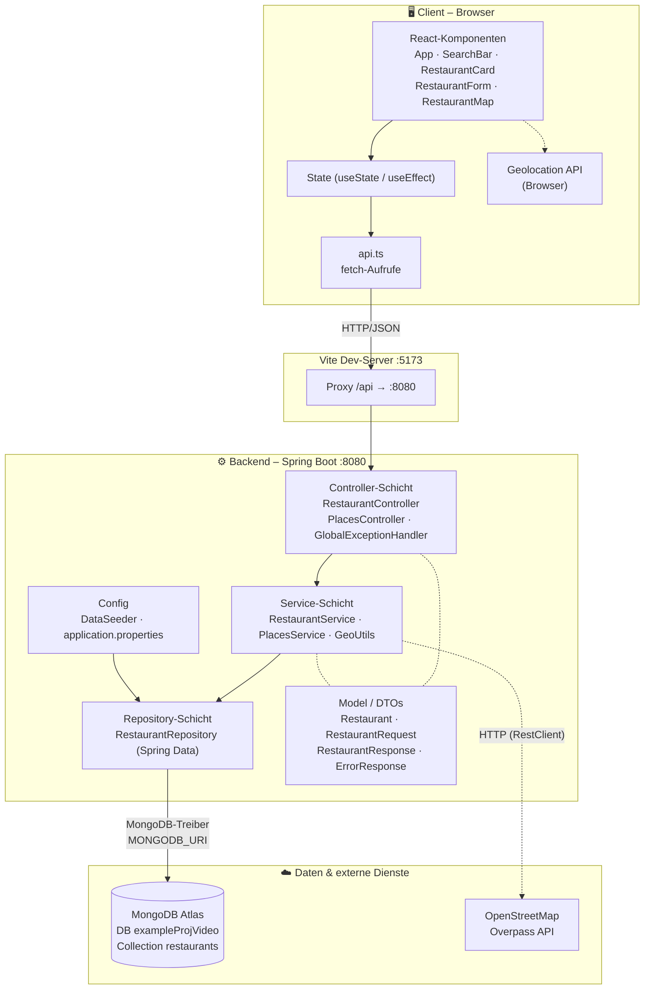
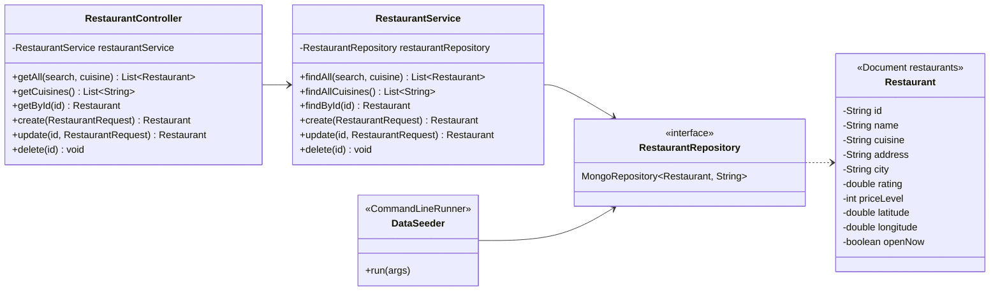
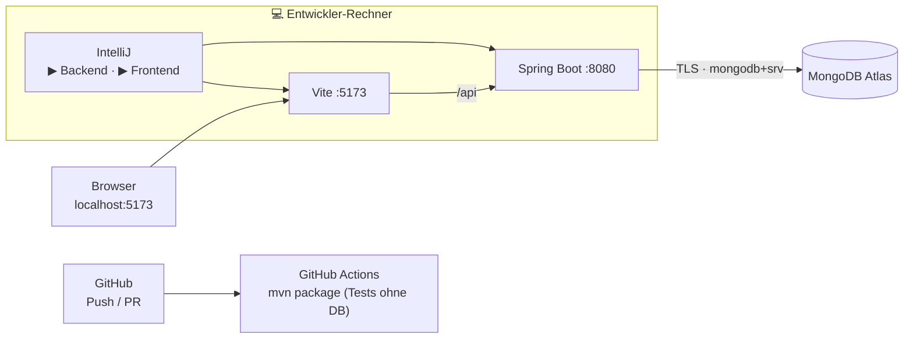
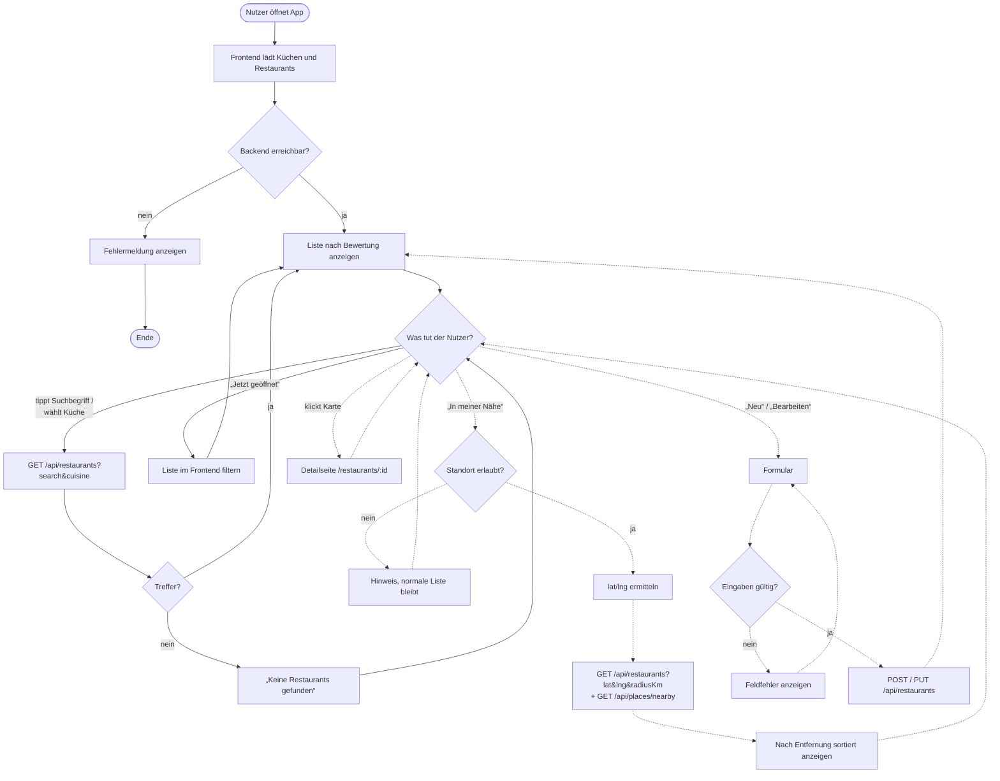
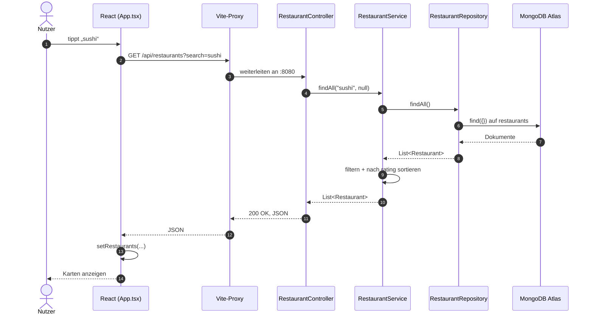
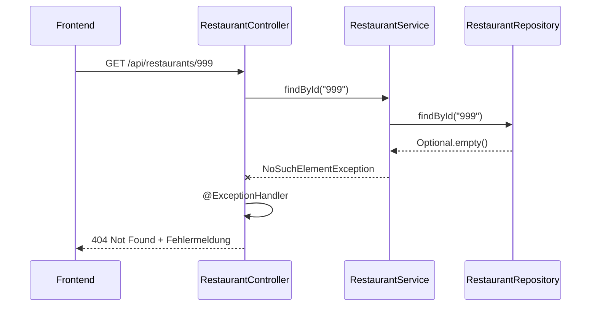
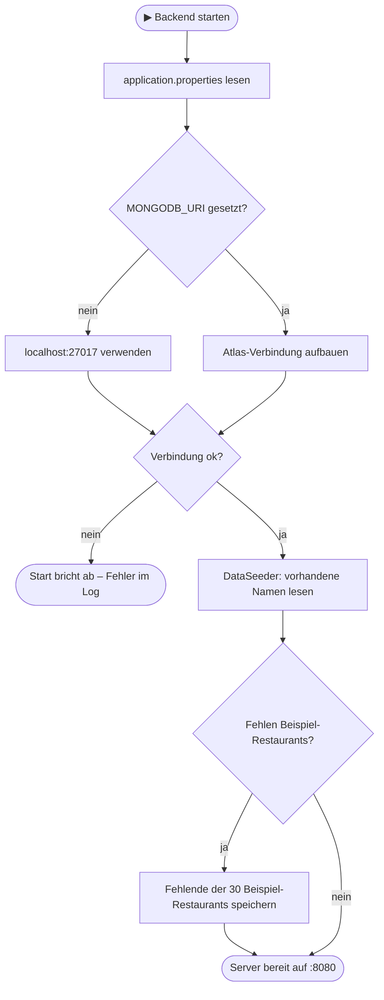

# Restaurant Finder – Software-Architektur & Ablaufdiagramme

Ergänzung zu [PLAN.md](PLAN.md). Die Diagramme sind in Mermaid geschrieben und werden
auf GitHub und in der IntelliJ-Markdown-Vorschau als Grafik angezeigt.

Legende: durchgezogen = umgesetzt · gestrichelt = geplant

---

## 1. Software-Architektur

### 1.1 Systemübersicht (3-Schichten / Client-Server)



### 1.2 Verantwortung der Schichten

| Schicht      | Aufgabe                                                        | Darf aufrufen         |
|--------------|----------------------------------------------------------------|-----------------------|
| Controller   | HTTP annehmen, Parameter prüfen, Statuscodes, DTO ↔ JSON       | Service               |
| Service      | Geschäftslogik: Suche, Filter, Sortierung, Entfernung, OSM     | Repository, externe API |
| Repository   | Datenbankzugriff (CRUD), keine Logik                           | MongoDB               |
| Model / DTO  | Datenstrukturen (Lombok `@Data`, `@Builder`)                   | –                     |
| Config       | Startdaten, Verbindung, Einstellungen                          | Repository            |

Regel: Aufrufe gehen **nur von oben nach unten**. Der Controller spricht nie direkt mit dem Repository.

### 1.3 Klassendiagramm Backend



`create`, `update`, `delete` sind geplant (Phase 3).

### 1.4 Ordnerstruktur

```
ExampleProjVideo/
├── backend/                         Spring Boot (Maven)
│   └── src/main/java/org/example/backend/
│       ├── controller/              REST-Endpunkte
│       ├── service/                 Logik
│       ├── repository/              MongoDB-Zugriff
│       ├── model/                   Restaurant + DTOs
│       └── config/                  DataSeeder
├── frontend/                        React + Vite
│   └── src/
│       ├── components/              SearchBar, RestaurantCard …
│       ├── types.ts                 TypeScript-Typen (= API-Vertrag)
│       └── App.tsx                  Hauptseite
├── docs/                            PLAN.md, ARCHITEKTUR.md
└── .github/workflows/maven.yml      CI: Backend bauen + testen
```

### 1.5 Deployment / Laufzeit (Entwicklung)



---

## 2. Ablaufdiagramme

### 2.1 Gesamtablauf aus Nutzersicht



### 2.2 Ablauf einer Anfrage durch das System (Liste laden)



### 2.3 Fehlerfall: Restaurant nicht gefunden



### 2.4 Start des Backends


