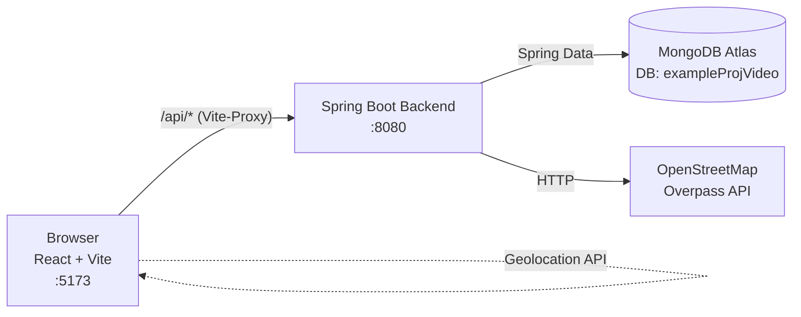
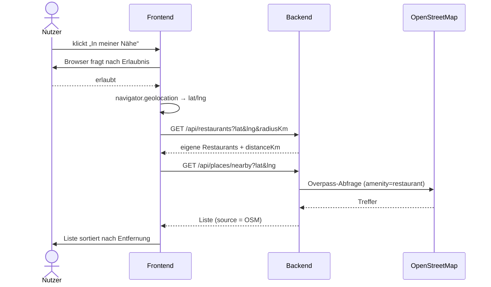

# Restaurant Finder – Projektplan & Schnittstellen

Status: Entwurf · Stand 12.11.2026

Legende: ✅ umgesetzt · 🔜 geplant

---

## 1. Überblick

Die App zeigt Restaurants, lässt sie suchen und filtern, eigene Einträge verwalten
und – über den Standort des Nutzers – echte Restaurants in der Nähe finden.



| Teil      | Technik                                   | Ordner      | Port |
|-----------|-------------------------------------------|-------------|------|
| Frontend  | React 19, TypeScript, Vite                | `frontend/` | 5173 |
| Backend   | Spring Boot 4, Java 25, Lombok, Maven     | `backend/`  | 8080 |
| Datenbank | MongoDB Atlas, Collection `restaurants`   | –           | –    |
| Extern 🔜 | OpenStreetMap Overpass API (kein Key)     | –           | –    |

**Ablauf einer Anfrage:** Frontend ruft `/api/...` auf → Vite leitet an `localhost:8080` weiter →
`Controller` → `Service` (Logik, Filter, Entfernung) → `Repository` → MongoDB.

**Konfiguration:** Connection String über Umgebungsvariable `MONGODB_URI`
(IntelliJ: Run-Konfiguration → Environment variables). Wird nie committet.

---

## 2. Backend-Schichten

```
org.example.backend
├── controller   RestaurantController ✅, PlacesController 🔜, GlobalExceptionHandler 🔜
├── service      RestaurantService ✅, PlacesService 🔜 (OSM), GeoUtils 🔜 (Haversine)
├── repository   RestaurantRepository ✅ (MongoRepository)
├── model        Restaurant ✅ (Document), RestaurantRequest 🔜, RestaurantResponse 🔜, ErrorResponse 🔜
└── config       DataSeeder ✅ (Beispieldaten, nur bei leerer Collection)
```

---

## 3. Datenmodell

### 3.1 `Restaurant` (MongoDB-Dokument, Collection `restaurants`) ✅

| Feld         | Typ     | Pflicht | Regeln                       | Beispiel           |
|--------------|---------|---------|------------------------------|--------------------|
| `id`         | string  | auto    | von MongoDB vergeben         | `"6733f1…"`        |
| `name`       | string  | ja      | 1–100 Zeichen                | `"Sakura Sushi"`   |
| `cuisine`    | string  | ja      | 1–50 Zeichen                 | `"Japanisch"`      |
| `address`    | string  | ja      | 1–200 Zeichen                | `"Ehrenstraße 45"` |
| `city`       | string  | ja      | 1–100 Zeichen                | `"Köln"`           |
| `rating`     | number  | nein    | 0.0 – 5.0                    | `4.4`              |
| `priceLevel` | int     | nein    | 1 – 4 (€ bis €€€€)           | `3`                |
| `latitude`   | number  | ja      | −90 … 90                     | `50.9390`          |
| `longitude`  | number  | ja      | −180 … 180                   | `6.9420`           |
| `openNow`    | boolean | nein    | Standard `false`             | `true`             |

### 3.2 `RestaurantRequest` (Body für POST/PUT) 🔜

Wie `Restaurant`, aber **ohne `id`**. Validierung mit `spring-boot-starter-validation`
(`@NotBlank`, `@DecimalMin`, `@Max` …).

### 3.3 `RestaurantResponse` (Antwort an das Frontend) 🔜

Wie `Restaurant`, plus:

| Feld         | Typ            | Bedeutung                                                   |
|--------------|----------------|-------------------------------------------------------------|
| `distanceKm` | number \| null | Entfernung zum Nutzer, nur wenn `lat`/`lng` mitgeschickt    |
| `source`     | string         | `"DB"` (eigene Daten) oder `"OSM"` (OpenStreetMap)          |

### 3.4 `ErrorResponse` (einheitliches Fehlerformat) 🔜

```json
{
  "status": 404,
  "error": "Not Found",
  "message": "Restaurant 999 nicht gefunden",
  "timestamp": "2026-11-12T16:40:00Z"
}
```

---

## 4. REST-Schnittstellen

Basis-URL: `/api` · Format: JSON · Zeichensatz: UTF-8

### Übersicht

| #  | Methode | Pfad                          | Zweck                                   | Status |
|----|---------|-------------------------------|-----------------------------------------|--------|
| 1  | GET     | `/api/restaurants`            | Liste, Suche, Filter, Umkreis           | ✅ (Umkreis 🔜) |
| 2  | GET     | `/api/restaurants/cuisines`   | Alle vorhandenen Küchen                 | ✅     |
| 3  | GET     | `/api/restaurants/{id}`       | Ein Restaurant                          | ✅     |
| 4  | POST    | `/api/restaurants`            | Restaurant anlegen                      | 🔜     |
| 5  | PUT     | `/api/restaurants/{id}`       | Restaurant ändern                       | 🔜     |
| 6  | DELETE  | `/api/restaurants/{id}`       | Restaurant löschen                      | 🔜     |
| 7  | GET     | `/api/places/nearby`          | Echte Restaurants aus OpenStreetMap     | ✅     |
| 8  | POST    | `/api/places/import`          | OSM-Treffer in eigene DB übernehmen     | 🔜 (optional) |

### 4.1 `GET /api/restaurants`

| Query-Parameter | Typ    | Pflicht | Bedeutung                                              |
|-----------------|--------|---------|--------------------------------------------------------|
| `search`        | string | nein    | Teiltext in Name, Küche oder Adresse (ohne Groß/klein) |
| `cuisine`       | string | nein    | Exakte Küche, z. B. `Italienisch`                      |
| `openNow`       | bool   | nein 🔜 | Nur geöffnete                                          |
| `lat`, `lng`    | number | nein 🔜 | Standort des Nutzers – beide oder keiner               |
| `radiusKm`      | number | nein 🔜 | Nur mit `lat`/`lng`; Standard 5, max. 50               |

Sortierung: mit Standort nach `distanceKm` aufsteigend, sonst nach `rating` absteigend.

```
GET /api/restaurants?search=sushi&lat=50.94&lng=6.95&radiusKm=3
```
`200 OK`
```json
[
  {
    "id": "6733f1a2b4c5d6e7f8a9b0c1",
    "name": "Sakura Sushi",
    "cuisine": "Japanisch",
    "address": "Ehrenstraße 45",
    "city": "Köln",
    "rating": 4.4,
    "priceLevel": 3,
    "latitude": 50.939,
    "longitude": 6.942,
    "openNow": true,
    "distanceKm": 0.57,
    "source": "DB"
  }
]
```
Fehler: `400` wenn nur `lat` oder nur `lng`, oder Werte außerhalb des Bereichs.

### 4.2 `GET /api/restaurants/cuisines` ✅

`200 OK` → `["Amerikanisch", "Französisch", "Indisch", "Italienisch", "Japanisch", "Türkisch"]`

### 4.3 `GET /api/restaurants/{id}` ✅

`200 OK` → ein `RestaurantResponse` · `404` → `ErrorResponse`

### 4.4 `POST /api/restaurants` 🔜

Body: `RestaurantRequest`
```json
{
  "name": "Pho Saigon",
  "cuisine": "Vietnamesisch",
  "address": "Aachener Str. 20",
  "city": "Köln",
  "rating": 4.2,
  "priceLevel": 2,
  "latitude": 50.9365,
  "longitude": 6.9301,
  "openNow": true
}
```
`201 Created` + Header `Location: /api/restaurants/{neueId}` + Body `RestaurantResponse`
· `400` bei Validierungsfehlern (Message nennt das Feld)

### 4.5 `PUT /api/restaurants/{id}` 🔜

Body: `RestaurantRequest` (vollständig) → `200 OK` + `RestaurantResponse` · `400` · `404`

### 4.6 `DELETE /api/restaurants/{id}` 🔜

`204 No Content` · `404`

### 4.7 `GET /api/places/nearby` ✅

Holt echte Restaurants live aus OpenStreetMap. Wird **nicht** gespeichert. Kein API-Key nötig.

| Query-Parameter | Typ    | Pflicht            | Bedeutung                                  |
|-----------------|--------|--------------------|--------------------------------------------|
| `city`          | string | entweder … | Stadt oder Adresse, z. B. `Köln`            |
| `lat`, `lng`    | number | … oder beide       | Standort (z. B. aus dem Browser)            |
| `radiusKm`      | number | nein               | Standard 2, erlaubt 0,1 – 5                 |

**Ablauf im Backend (`PlacesService`):**
1. Nur bei `city`: **Nominatim** wandelt den Namen in Koordinaten um (`404`, wenn nicht gefunden).
2. **Overpass** sucht alle `amenity=restaurant` im Umkreis (max. 12 s Wartezeit, mehrere Server möglich).
3. Fällt Overpass aus → **Nominatim-Restaurantsuche** als Ausweichquelle (max. 40 Treffer).
4. Entfernung per Haversine berechnen, außerhalb des Radius verwerfen, nach Entfernung sortieren, max. 50.

Nominatim wird höchstens 1× pro Sekunde aufgerufen (Nutzungsregel). Jede Anfrage trägt den
User-Agent `RestaurantFinder/0.1 (Abschlussprojekt)`.

```
GET /api/places/nearby?city=Köln&radiusKm=1
```
`200 OK`
```json
{
  "latitude": 50.938361,
  "longitude": 6.959974,
  "locationName": "Köln, Nordrhein-Westfalen, Deutschland",
  "provider": "Nominatim",
  "radiusKm": 1.0,
  "places": [
    {
      "id": "osm-node-427539891",
      "name": "Peters Brauhaus",
      "cuisine": "Deutsch",
      "address": "Mühlengasse 1",
      "city": "Köln",
      "latitude": 50.9386,
      "longitude": 6.9611,
      "distanceKm": 0.1,
      "openingHours": "Mo-Th 11:30-23:00; Fr-Sa 11:30-24:00",
      "website": "https://…",
      "source": "OSM"
    }
  ]
}
```

| Feld         | Bedeutung                                                              |
|--------------|------------------------------------------------------------------------|
| `provider`   | `Overpass` (vollständig) oder `Nominatim` (Ausweichquelle)             |
| `cuisine`    | ins Deutsche übersetzt (`CuisineTranslator`), `null` wenn unbekannt    |
| `address`, `city`, `openingHours`, `website` | können `null` sein (nicht jedes Restaurant pflegt sie) |

Fehler: `400` (keine/ungültige Parameter, Radius außerhalb) · `404` (Ort nicht gefunden)
· `502` (OpenStreetMap komplett nicht erreichbar). Body jeweils `{"status", "error", "message", "path", "timestamp"}`.

### 4.8 `POST /api/places/import` 🔜 (optional)

Body: ein OSM-Treffer aus 4.7 → wird als eigenes Restaurant gespeichert → `201 Created`.

---

## 5. Frontend

### Seiten (React Router 🔜)

| Route                       | Inhalt                                             | Nutzt API      |
|-----------------------------|----------------------------------------------------|----------------|
| `/`                         | Suche, Filter, Liste der Karten ✅, Standort-Button 🔜 | 1, 2, 7     |
| `/restaurants/:id`          | Detailseite mit Karte (Leaflet + OSM-Kacheln) 🔜   | 3              |
| `/restaurants/new`          | Formular „Restaurant anlegen“ 🔜                   | 4              |
| `/restaurants/:id/edit`     | Formular „Bearbeiten“, Button „Löschen“ 🔜         | 3, 5, 6        |

### Komponenten

`SearchBar` ✅ · `RestaurantCard` ✅ · `LocationButton` 🔜 · `RestaurantForm` 🔜 · `RestaurantMap` 🔜 · `api.ts` 🔜 (alle `fetch`-Aufrufe an einer Stelle)

### Standort-Ablauf 🔜



Verweigert der Nutzer den Standort, bleibt die normale Liste und es erscheint ein Hinweis.

---

## 6. Umsetzungsreihenfolge

| Phase | Inhalt                                                                 | Ergebnis                          |
|-------|------------------------------------------------------------------------|-----------------------------------|
| 1 ✅  | Grundgerüst, Liste/Suche/Filter, MongoDB, Beispieldaten                | App läuft mit Atlas               |
| 2     | DTOs, Validierung, `GlobalExceptionHandler`, `ErrorResponse`           | Saubere Schnittstelle, Tests      |
| 3     | CRUD (POST/PUT/DELETE) + Formulare + React Router                      | Eigene Restaurants verwalten      |
| 4     | Standort: Geolocation im Frontend, `lat/lng/radiusKm`, Haversine       | „In meiner Nähe“ mit eigenen Daten|
| 5 ✅  | OpenStreetMap: `/api/places/nearby` (Overpass + Nominatim-Fallback)    | Echte Restaurants                 |
| 6     | Karte (Leaflet), Feinschliff, README, Präsentation                     | Abgabe                            |

Jede Phase: Unit-Tests (Service, Mockito) + Controller-Tests (MockMvc, Repository gemockt),
eigener Branch → Pull Request → GitHub Actions grün → Merge.

---

## 7. Offene Entscheidungen

1. **Login/Benutzer?** Sollen nur angemeldete Nutzer anlegen/löschen dürfen? (Aktuell: nein, jeder.)
2. **Bewertungen:** fester Wert pro Restaurant oder echte Nutzerbewertungen (eigene Collection `reviews`)?
3. **Favoriten** speichern?
4. **Umkreissuche in MongoDB** (`$near` mit 2dsphere-Index) statt im Java-Code – lohnt sich erst bei vielen Daten.
